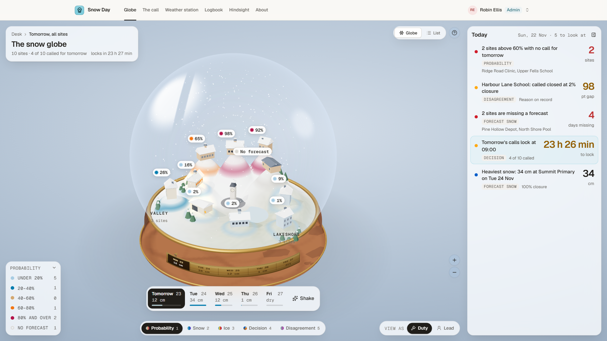

# Snow Day

A snow-day decision desk for facilities, schools and field teams. Site leads enter the forecast per site, a transparent
model fitted to your own past calls gives each site a closure probability, the duty manager makes the call with a
reason before the 09:00 lock, and every call and what the day brought stays on record. The home screen is a snow globe:
a tiny town under glass where each site is a building on its own hill, the snow falls at the forecast and the windows
show the call.



## The problem

At 5 am someone decides whether a site opens in the snow, from a weather app and a hunch, and nobody records why, so
next winter's call is a hunch again. Snow Day keeps the decision honest and the record complete:

1. **Closure probability**: a logistic model on forecast snow, minimum temperature, wind, ice risk, elevation, exposure
   and road class, fitted to past calls (closed or remote = 1). With fewer than **15** past calls it uses a hand-set
   prior; after that a ridge penalty pulls the fit toward the prior. Coefficients and their meaning are on the About page.
2. **Against the model**: a call whose weight (open 0, delayed 0.5, closed or remote 1) differs from the probability by
   more than **0.35** needs a reason of at least **30** characters.
3. **The 09:00 lock**: calls for a day lock at 09:00 site time; a later change is a new decision whose reason starts
   "Revised" (30+ characters) and the call it replaces stays on record.
4. **Hit rate**: past calls judged against outcomes. Closed or remote with under **2 cm** and at most **1** incident is
   over-cautious; open with **10 cm** or more, or open or delayed with **3**+ incidents, is caught out.

It supports the process and keeps its record; it is not a weather service and not safety, legal or health and safety advice.

## What it looks like

**The snow globe** (three.js, lazy-loaded): a glass globe on a turned wooden base. Each site is a building on a hill as
high as the site, grouped by region round a town square whose clock counts down to the lock. Roads are as wide as their
class and are buried by snow in the order the ploughs reach them; sheltered sites stand behind pines. Snow falls over
each site at its forecast for the selected day and settles on its roofs; windows show the call (warm open, amber
delayed, dark closed, blue remote, a flicker for no call). The brass plaque on the base is the five-day dial; drag to
turn the globe; **Shake** (S) replays the night's snowfall.

- Lenses (1–5): probability, forecast snow, ice risk, decision, model disagreement.
- View as (V): duty manager or site lead. Today: likely closures with no call, calls against the model, missing
  forecasts, the 09:00 countdown, the heaviest snow ahead. Each item flies to the site and switches lens.
- Fallbacks: the list view (L) is the decision table for the selected day; `?nowebgl` draws the town from above in SVG
  with the same encodings; reduced motion stops the snow, the flights and the shake.
- Tools: **The call** (decide per site with the probability, its drivers and the reason rules), **Weather station**
  (five-day outlook, log a forecast, CSV import, the site register), **Logbook** (every call and outcome, revisions,
  CSV and print), **Hindsight** (hit rate, the model's own score, calibration, coefficients).

## Prerequisites

- Microsoft Fabric with the Fabric Apps workload enabled, a workspace on a capacity, and Edit permission on it.
- Node 20+.
- Site leads and the duty manager need access to the app item (workspace members get it by default).

## Run locally

```bash
npm install            # at the repo root
npm run dev            # demo mode: in-memory store, seed data and a persona switcher (port 5230)
npm run dev:fabric     # against Fabric (after rayfin login)
```

## Deploy

```bash
npx rayfin up --workspace-id <id>
```

## Seed and make an admin

```bash
npm run seed:fabric -- --admin-email you@org.com
```

Open the app once first so your Person row exists. The seed maps the first persona (the duty manager) to you and sets
`isAdmin`. The manual equivalent: `UPDATE dbo.People SET isAdmin = 1 WHERE email = 'you@org.com';`

The seed: 10 fictional sites in 3 regions, two winters of forecasts, calls and outcomes generated from a fixed random
seed (so the model fits the same way every time), five days of forecasts from the desk day with a storm on day 2,
today's calls partly made (one against the model), two forecasts missing, and past revisions after the lock. Sites carry
no time zone of their own, so they follow the desk's.

## How it works

| Entity | Fields | Row policy |
|---|---|---|
| Site | name, region, elevation, exposure, roadClass, leadSub?, leadName?, timeZone? | read; create/update open (admin only in the domain); no delete |
| Forecast | siteId, day, snowCm, tempMinC, windKmh, iceRisk, source, enteredBy, enteredAt | read; create only as yourself (`claims.sub = enteredBy`); no update/delete |
| Decision | siteId, day, call, reason, decidedBy, decidedAt, modelProbability? | read; create only as yourself (`claims.sub = decidedBy`); no update/delete |
| Outcome | siteId, day, actualSnowCm, incidents, note?, enteredBy, enteredAt | read; create only as yourself (`claims.sub = enteredBy`); no update/delete |
| Person, AppMarker | shared | as generated |

The record is append-only: the newest forecast, decision and outcome for a site and day is the one in force, and older
rows stay as history. The model is refitted in the browser every time the desk loads (`src/domain/closure.ts`, Newton's
method on standardised inputs), on days before the current call day only.

- Pure rules with unit tests: `src/domain/closure.ts` (model), `rules.ts` (gap, revision, verdicts, calibration),
  `time.ts` (site time and the lock), `desk.ts` (joins), `today.ts`, `hindsight.ts`.
- Domain functions with the permission checks (both modes): `src/domain/actions.ts`. Only the duty manager makes calls
  and edits sites; site leads enter forecasts and outcomes for their own sites; the 09:00 revision and override reason
  rules are checked before any write.

## Known limits

- There is no admin claim in the policy DSL, so "only the duty manager makes calls or edits sites" and "a lead writes
  only for their own sites" are enforced in the domain, not the database. A signed-in user calling the GraphQL API
  directly could create a decision as themselves, or edit a site; the record still shows who did it.
- The override reason length and the "Revised" wording are domain rules; the database only enforces the 3–400 length.
- Time zones: a site without a time zone follows the viewer's browser, so desks spanning zones should set them.
- The model is a plain logistic regression; it learns the desk's habits, good and bad.

## Later

- Import forecasts straight from a weather service connector instead of CSV.
- Notify site leads when the call is made, and a printable 5 am briefing.
- Database-level admin enforcement with dynamic auth claims.

## Gallery

**Title:** 12 Days of Fabric Apps: Day 10 – Snow Day Forecaster

**Blurb (80 words):** Snow Day turns the 5 am closure call into a recorded decision. Each site is a building
inside a snow globe; snow falls at the forecast, windows show the call, and a brass dial steps through five days. A
logistic model fitted to your past calls gives every site a closure probability; calls against it need a reason,
calls lock at 09:00, and Hindsight scores every decision against what the day brought. Built by Datachain Consulting for
AI at Work.

**Tags:** Partner | 12 Days of Fabric Apps, Fabric Apps, SQL database, Operations, Facilities
